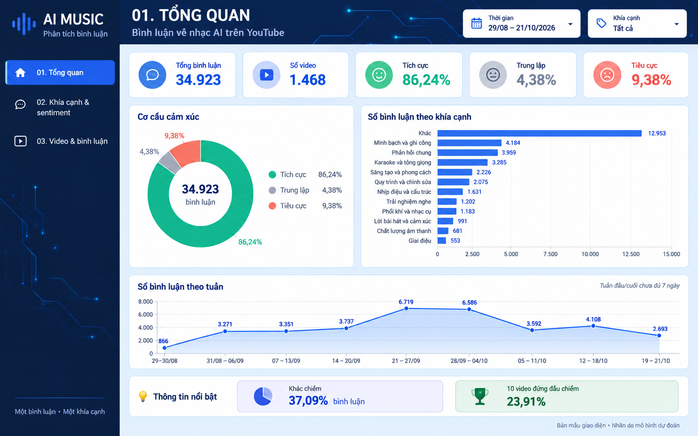
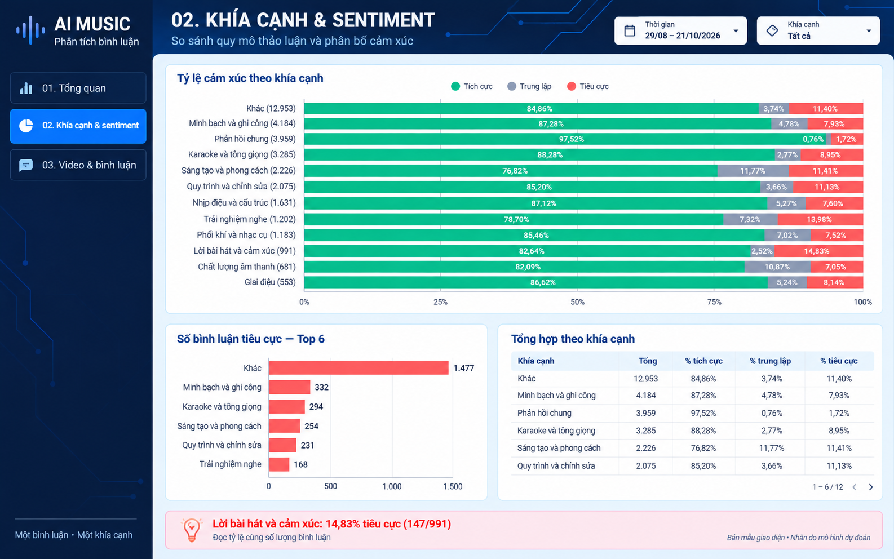
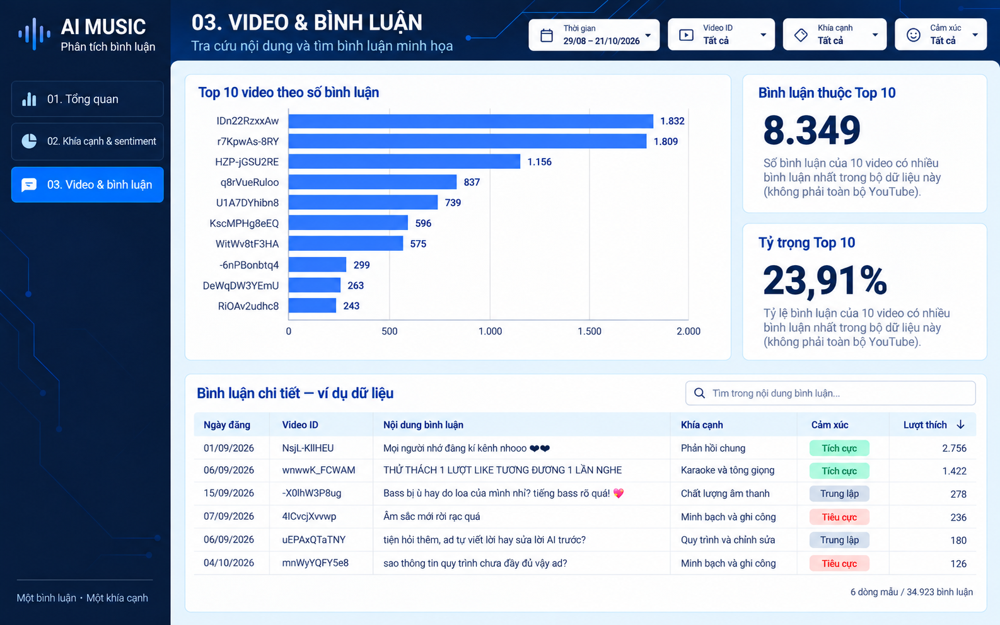

# Mẫu thiết kế dashboard Looker Studio

Ba ảnh minh họa bố cục và màu sắc cho dashboard phân tích bình luận nhạc AI. Đây là ảnh thiết kế tĩnh, không phải dashboard có thể tương tác. Khi triển khai, các biểu đồ và bộ lọc cần kết nối với dữ liệu thực tế trong BigQuery; không dùng số liệu hoặc chữ đọc từ ảnh làm nguồn dữ liệu.

## Trang 1 — Tổng quan

## Trang 2 — Khía cạnh và sentiment

## Trang 3 — Video và bình luận

Mỗi bình luận được gán một khía cạnh chính. Sentiment là cảm xúc chung của cả bình luận do mô hình dự đoán.
